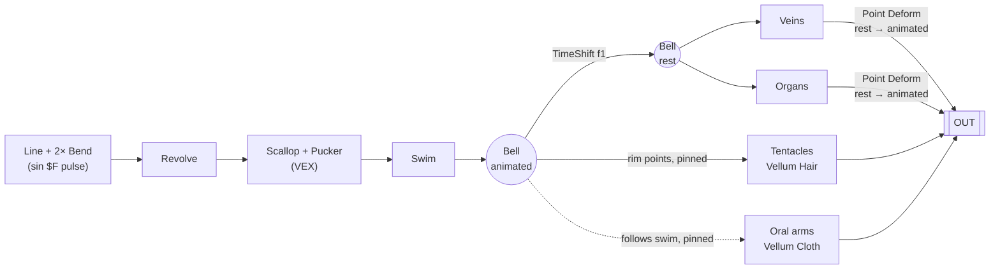
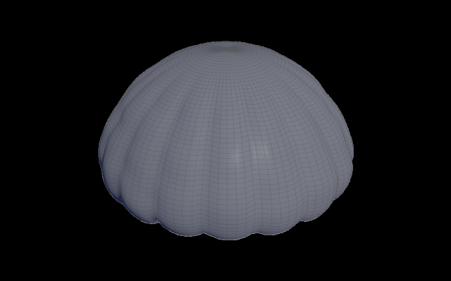
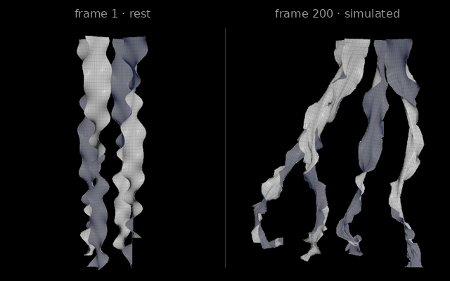
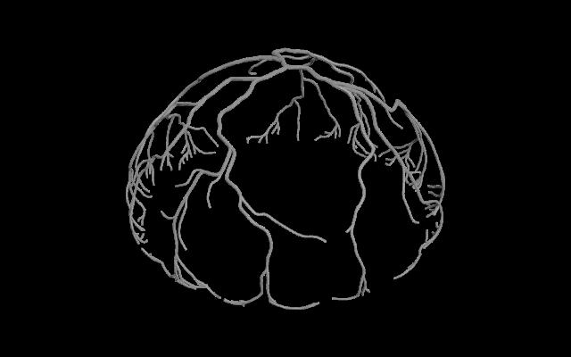
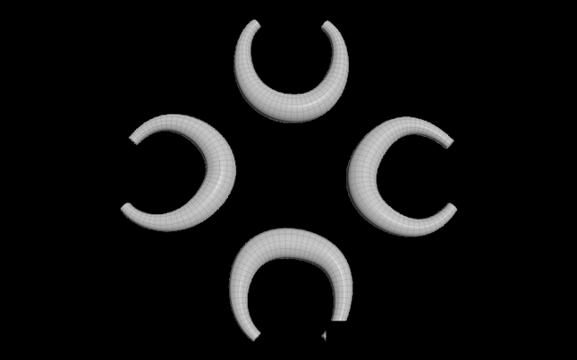
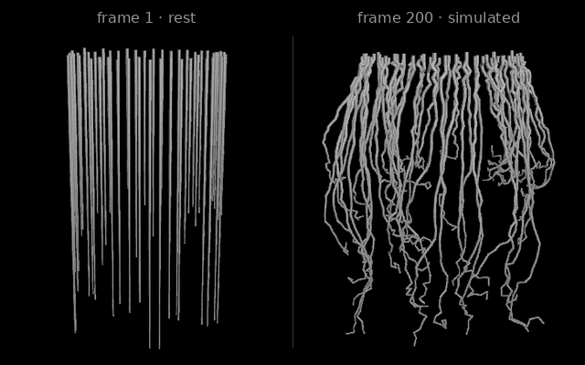
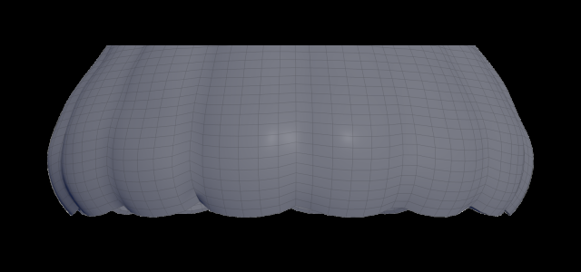

# Procedural Jellyfish

A pulsing moon jelly built entirely in Houdini (SOPs · VEX · Vellum). Every part is driven by one animated bell surface.

https://github.com/user-attachments/assets/9cb47216-1556-4fed-a80d-4aa19b2f59b8

## How it fits together

Attached parts ride the bell with **Point Deform**; simulated parts are **pinned with Match Animation**, so a single change to the bell propagates everywhere.

## Parts

<table>
<tr>
<td width="48%"></td>
<td><b>Bell</b> A bent line revolved into a dome. Both bend angles follow <code>sin($F·12)</code> for the contraction cycle, plus a small rise per stroke. <code>Line</code> · <code>Bend ×2</code> · <code>Revolve</code> · <code>Transform</code></td>
</tr>
<tr>
<td></td>
<td><b>Oral arms</b> Grids tapered, ruffled and twisted 300° in VEX, copied ×4 around the axis, then simulated as cloth with the root row pinned to the bell. <code>Grid</code> · <code>Wrangle</code> · <code>Copy and Transform</code> · <code>Vellum Cloth</code></td>
</tr>
<tr>
<td></td>
<td><b>Veins</b> Remeshed bell → shortest paths from the apex to random rim/mid points. A noise point-cost makes the branches wander instead of running straight. <code>Remesh</code> · <code>Find Shortest Path</code> · <code>Fuse</code> · <code>Resample</code> · <code>Smooth</code> · <code>Sweep</code> · <code>Point Deform</code></td>
</tr>
<tr>
<td></td>
<td><b>Organs</b> Four open arcs, noise-wobbled and swept into tubes that taper at both ends, placed under the apex. <code>Circle</code> · <code>Copy and Transform</code> · <code>Sweep</code> · <code>Point Deform</code></td>
</tr>
<tr>
<td></td>
<td><b>Tentacles</b> 50 polylines grown from every other rim column in VEX with random lengths. Vellum Hair with pinned roots and a <code>POP Force</code> noise for drift. <code>Wrangle</code> · <code>Vellum Hair</code> · <code>POP Force</code> · <code>Sweep</code></td>
</tr>
</table>

## Extra Credit — Refined bell

One VEX pass after the revolve, weighted from apex (0) to rim (1):
- **Scalloped margin** — 16 lobes that bulge out and sag, `pow(|sin 8θ|, 0.6)`, masked by `t⁵` so only the rim moves.
- **Puckering** — radial grooves `cos⁶ 8θ` plus noise dents, masked to the mid-bell.

## Gotcha

Vellum writes the hair thickness to `pscale`, and Sweep multiplies its radius by it — turn off *Transform Using Curve Point Attributes* or the tentacles all but disappear.
